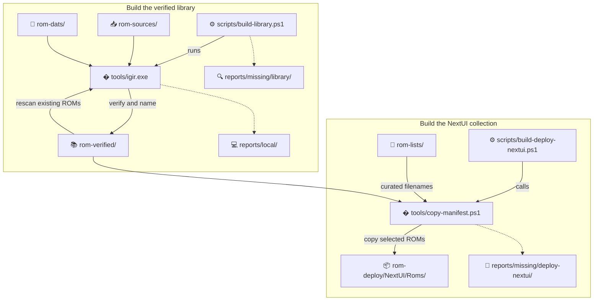

# ROM Foundry

A curated retro ROM library workflow.

Focus: bulk verification and curation of large ROM catalogues. Disc-based systems such as PlayStation can have manually followed shortlists, without automated library or deployment builds.

## Workflow

## Collection status

- **Library completion:** Progress towards a complete catalogue.
- **Curated completion:** Progress towards having every game in our selection. A dash means the list exists but availability has not been checked.
- **Completion bars:** Each filled bar represents 10% available. All ten means complete; empty meters are omitted.

| NextUI folder | Curated completion | Library completion | DAT | Notes |
|---|---:|---:|---|---|
| Amiga (PUAE) | —/431 | —/5797 | `No-Intro/Commodore - Amiga (Parent-Clone) (20260817-003537).dat` |  |
| Amstrad CPC (CPC) | —/1 | —/1 | `No-Intro/Amstrad - CPC (Misc) (Parent-Clone) (20230406-091045).dat` | One-game starter. |
| Amstrad CPC (CPC) | —/138 | —/4669 | `TOSEC/Amstrad CPC - Games - [DSK] (TOSEC-v2025-01-15_CM).dat` | 127 games; includes additional disks. |
| Arcade (FBN) | 299/416 71.9% ███████░░░ | 6159/8047 76.5% ███████░░░ | `FBNeo/FinalBurn Neo (ClrMame Pro XML, Arcade only).dat` | 411 games + 5 support sets. |
| Atari 2600 (A2600) | —/196 | —/906 | `No-Intro/Atari - Atari 2600 (Parent-Clone) (20261024-053438).dat` |  |
| Atari 5200 (A5200) | —/66 | —/207 | `No-Intro/Atari - Atari 5200 (Parent-Clone) (20260412-121350).dat` |  |
| Atari 7800 (A7800) | —/52 | —/252 | `No-Intro/Atari - Atari 7800 (BIN) (Parent-Clone) (20260903-044143).dat` |  |
| Atari Lynx (LYNX) | —/61 | —/437 | `No-Intro/Atari - Atari Lynx (LYX) (Parent-Clone) (20260625-122811).dat` |  |
| Colecovision (COLECO) | —/100 | —/201 | `No-Intro/Coleco - ColecoVision (Parent-Clone) (20260710-180934).dat` |  |
| Commodore 128 (C128) | —/26 | —/195 | `TOSEC/Commodore C128 - Games - [D64] (TOSEC-v2025-01-15_CM).dat` | 24 games; includes additional disk sides. |
| Commodore 128 (C128) | —/2 | —/13 | `TOSEC/Commodore C128 - Games - [D71] (TOSEC-v2025-01-15_CM).dat` | Text adventures; keyboard-heavy. |
| Commodore 128 (C128) | —/2 | —/94 | `TOSEC/Commodore C128 - Games - [PRG] (TOSEC-v2025-01-15_CM).dat` | Supplements the disk selections. |
| Commodore 64 (C64) | —/104 | —/394 | `No-Intro/Commodore - Commodore 64 (Parent-Clone) (20261024-051621).dat` |  |
| Commodore PET (PET) | —/1 | —/2 | `TOSEC/Commodore PET - Games - [D64] (TOSEC-v2024-01-15_CM).dat` | BioTerror!; keyboard-heavy. |
| Commodore PET (PET) | —/30 | —/113 | `TOSEC/Commodore PET - Games - [PRG] (TOSEC-v2025-01-15_CM).dat` |  |
| Commodore Plus4 (PLUS4) | —/2 | —/39 | `No-Intro/Commodore - Plus-4 (Parent-Clone) (20090105-000000).dat` |  |
| Commodore VIC20 (VIC) | —/96 | —/310 | `No-Intro/Commodore - VIC-20 (Parent-Clone) (20231226-072946).dat` |  |
| Doom (PRBOOM) |  |  |  |  |
| Famicom Disk System (FDS) | 8/40 20.0% ██░░░░░░░░ | 85/408 20.8% ██░░░░░░░░ | `No-Intro/Nintendo - Family Computer Disk System (FDS) (Parent-Clone) (20261020-110152).dat` |  |
| Game Boy (GB) | 78/78 100.0% ██████████ | 548/2347 23.3% ██░░░░░░░░ | `No-Intro/Nintendo - Game Boy (Parent-Clone) (20261024-134731).dat` |  |
| Game Boy Advance (MGBA) | 237/244 97.1% █████████░ | 2799/3788 73.9% ███████░░░ | `No-Intro/Nintendo - Game Boy Advance (Parent-Clone) (20261025-113312).dat` | More accurate; GBA suffices. |
| Game Boy Color (GBC) | 175/177 98.9% █████████░ | 1375/2684 51.2% █████░░░░░ | `No-Intro/Nintendo - Game Boy Color (Parent-Clone) (20261026-034426).dat` |  |
| Intellivision (INTV) | —/79 | —/315 | `No-Intro/Mattel - Intellivision (Parent-Clone) (20260811-144508).dat` | Requires the INTV emulator pak; keypad mappings matter. |
| Microsoft MSX (MSX) | —/162 | —/952 | `No-Intro/Microsoft - MSX (Parent-Clone) (20260618-055428).dat` |  |
| Microsoft MSX (MSX) | —/61 | —/201 | `No-Intro/Microsoft - MSX2 (Parent-Clone) (20261025-205303).dat` | MSX2 cartridges; requires MSX2 mode. |
| Neo Geo Pocket (NGP) | 2/2 100.0% ██████████ | 6/13 46.2% ████░░░░░░ | `No-Intro/SNK - NeoGeo Pocket (Parent-Clone) (20250904-215533).dat` |  |
| Neo Geo Pocket Color (NGPC) | 19/38 50.0% █████░░░░░ | 72/128 56.3% █████░░░░░ | `No-Intro/SNK - NeoGeo Pocket Color (Parent-Clone) (20260919-122044).dat` |  |
| Nintendo Entertainment System (FC) | 296/306 96.7% █████████░ | 2720/7703 35.3% ███░░░░░░░ | `No-Intro/Nintendo - Nintendo Entertainment System (Headered) (Parent-Clone) (20261025-205653).dat` |  |
| Pico-8 (P8) |  |  |  |  |
| Pokémon mini (PKM) | —/9 | —/46 | `No-Intro/Nintendo - Pokemon Mini (Parent-Clone) (20260529-125415).dat` |  |
| Sega 32X (32X) | —/22 | —/227 | `No-Intro/Sega - 32X (Parent-Clone) (20261010-152927).dat` |  |
| Sega CD (SEGACD) | 45-game shortlist |  | `Redump/Sega - Mega CD & Sega CD - Datfile (549) (2026-10-23 10-16-53).dat` | Manual shortlist; no automated builds. |
| Sega Game Gear (GG) | —/153 | —/928 | `No-Intro/Sega - Game Gear (Parent-Clone) (20261023-073103).dat` |  |
| Sega Genesis (MD) | 285/311 91.6% █████████░ | 1106/3584 30.9% ███░░░░░░░ | `No-Intro/Sega - Mega Drive - Genesis (Parent-Clone) (20261025-103445).dat` |  |
| Sega Master System (SMS) | 202/203 99.5% █████████░ | 505/1241 40.7% ████░░░░░░ | `No-Intro/Sega - Master System - Mark III (Parent-Clone) (20261013-064924).dat` |  |
| Sega SG-1000 (SG1000) | —/58 | —/247 | `No-Intro/Sega - SG-1000 - SC-3000 (Parent-Clone) (20231205-110448).dat` |  |
| Sony PlayStation (PS) | 65-game shortlist |  | `Redump/Sony - PlayStation - Datfile (10982) (2026-10-27 23-02-45).dat` | Manual shortlist; no automated builds. |
| Super Game Boy (SGB) | 78/78 100.0% ██████████ | 548/2347 23.3% ██░░░░░░░░ | `No-Intro/Nintendo - Game Boy (Parent-Clone) (20261024-134731).dat` |  |
| Super Nintendo Entertainment System (SFC) | 314/325 96.6% █████████░ | 3325/4344 76.5% ███████░░░ | `No-Intro/Nintendo - Super Nintendo Entertainment System (Parent-Clone) (20261023-215722).dat` |  |
| Super Nintendo Entertainment System (SUPA) | 314/325 96.6% █████████░ | 3325/4344 76.5% ███████░░░ | `No-Intro/Nintendo - Super Nintendo Entertainment System (Parent-Clone) (20261023-215722).dat` |  |
| TurboGrafx-16 (PCE) | 54-title shortlist |  | `Redump/NEC - PC Engine CD & TurboGrafx CD - Datfile (551) (2026-10-23 10-18-16).dat` | CD games; manual shortlist, no automated builds. |
| TurboGrafx-16 (PCE) | —/176 | —/510 | `No-Intro/NEC - PC Engine - TurboGrafx-16 (Parent-Clone) (20260124-120557).dat` | HuCard/cartridge games |
| — | —/5 | —/6 | `No-Intro/NEC - PC Engine SuperGrafx (Parent-Clone) (20250913-112105).dat` | SuperGrafx: emulator pak and deployment folder to confirm. |
| — | —/21 | —/48 | `No-Intro/GCE - Vectrex (Parent-Clone) (20260525-000205).dat` | Vectrex: emulator pak and deployment folder to confirm. |
| Virtual Boy (VB) | 15/18 83.3% ████████░░ | 29/81 35.8% ███░░░░░░░ | `No-Intro/Nintendo - Virtual Boy (Parent-Clone) (20260804-192036).dat` |  |
| Bandai WonderSwan Color (WSC) | —/33 | —/257 | `No-Intro/Bandai - WonderSwan (Parent-Clone) (20261013-150902).dat` | Monochrome games; shares the WSC emulator pak. |
| Bandai WonderSwan Color (WSC) | —/23 | —/253 | `No-Intro/Bandai - WonderSwan Color (Parent-Clone) (20261018-083359).dat` | Requires the WSC emulator pak. |

## Future ideas

- Score games for quality and discovery value; generate curated manifests using a balance slider, game-count or storage budget, and personal overrides. Explore whether useful scoring across entire catalogues is practical.
